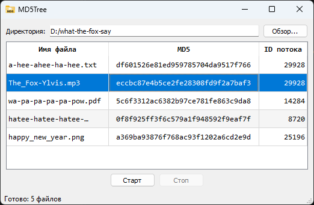

<table>
  <tr>
    <td></td>
    <td><h1>MD5Tree</h1></td>
  </tr>
</table>

**Русский** | [English](README.en.md)

Кроссплатформенное приложение на Qt Widgets для рекурсивного обхода
директорий и многопоточного вычисления MD5.



## Возможности

- Рекурсивный обход директорий и поддиректорий
- Многопоточное вычисление MD5 (`QThreadPool`, по одному `QRunnable` на файл)
- Таблица результатов: имя файла, MD5, ID потока
- Кнопки «Старт» / «Стоп» с кооперативной отменой
- Кроссплатформенность: Windows, Linux, macOS

## Запуск

**Windows:** скачайте `MD5Tree-0.1.0-win64.zip` со страницы Releases, распакуйте
и запустите `MD5Tree.exe`. Qt не требуется — всё включено.


- [Releases на GitHub](https://github.com/sun-demon/MD5Tree/releases)
- [Releases на Мос.Хаб](https://hub.mos.ru/sun-demon/md5tree/-/releases)

**Linux/macOS:** соберите из исходников (см. ниже).

## Сборка

```bash
# GitHub
git clone https://github.com/sun-demon/MD5Tree.git

# или Мос.Хаб
git clone https://hub.mos.ru/sun-demon/md5tree.git

cd MD5Tree
qmake MD5Tree.pro CONFIG+=release
make          # или mingw32-make на Windows
```

Требования: Qt 5.14.1+ (Widgets), компилятор с C++17.

## Использование

1. **Обзор…** — выбрать директорию в дереве папок. Файлы видны, но выбрать можно только папку.
2. **Старт** — начать сканирование.
3. **Стоп** — отменить. Уже обработанные строки остаются.
4. В таблице отображается относительный путь от выбранной директории; перед хешированием
   строки показываются в лексикографическом порядке, а ID потока — в десятичном виде.

Во время поиска строка состояния показывает анимированный индикатор, так как заранее
неизвестно общее число папок и файлов. Во время хеширования отображается процент
обработанных байт; число папок, файлов и объём данных доступны в подсказке индикатора.
Текущие файлы сразу появляются в таблице со статусом обработки. Все результаты
сохраняются в модели данных Qt без создания отдельных виджетов для каждой ячейки.

## Лицензия

MIT. См. [LICENSE](LICENSE).
